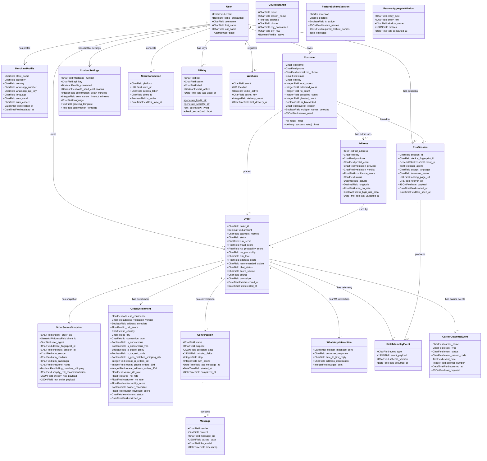

# Class Diagram – Risk Guard Platform

## Overview

The diagram covers all core domain models across the backend apps: **accounts**, **customers**, **addresses**, **orders**, **chatbot**, **stores**, **telemetry**, **risk\_engine**, and **ml\_models**.

---

## Class Diagram

---

## Relationship Summary

| Relationship | Type | Description |
|---|---|---|
| `User` → `MerchantProfile` | OneToOne | Each merchant has exactly one business profile |
| `User` → `ChatbotSettings` | OneToOne | Per-merchant WhatsApp chatbot configuration |
| `User` → `Customer` | OneToMany | Merchant owns their customer records |
| `Customer` → `Address` | OneToMany | A customer may have multiple delivery addresses |
| `User` → `Order` | OneToMany | Orders belong to a merchant |
| `Customer` → `Order` | OneToMany | A customer may place many orders |
| `Address` → `Order` | OneToMany | An address can be used across multiple orders |
| `Order` → `OrderSourceSnapshot` | OneToOne | Raw ingestion data captured at order creation |
| `Order` → `OrderEnrichment` | OneToOne | Derived scoring features (IP, address, velocity) |
| `Order` → `Conversation` | OneToOne | WhatsApp confirmation conversation per order |
| `Order` → `WhatsAppInteraction` | OneToOne | Summary of WhatsApp interaction per order |
| `Conversation` → `Message` | OneToMany | Conversation is made up of individual messages |
| `Order` → `CarrierOutcomeEvent` | OneToMany | Logistics events from the carrier |
| `RiskSession` → `RiskTelemetryEvent` | OneToMany | Browser/device events within a session |
| `User` → `StoreConnection` | OneToMany | E-commerce platform integrations per merchant |
| `User` → `APIKey` | OneToMany | API credentials per merchant |
| `User` → `Webhook` | OneToMany | Outbound event webhooks per merchant |

---

## App-Level Module Map

| App | Key Classes |
|---|---|
| `accounts` | `User`, `MerchantProfile` |
| `customers` | `Customer` |
| `addresses` | `Address`, `CourierBranch` |
| `orders` | `Order`, `OrderSourceSnapshot`, `OrderEnrichment` |
| `chatbot` | `ChatbotSettings`, `Conversation`, `Message`, `WhatsAppInteraction` |
| `stores` | `StoreConnection`, `APIKey`, `Webhook` |
| `telemetry` | `RiskSession`, `RiskTelemetryEvent` |
| `risk_engine` | `CarrierOutcomeEvent` |
| `ml_models` | `FeatureSchemaVersion`, `FeatureAggregateWindow` |
